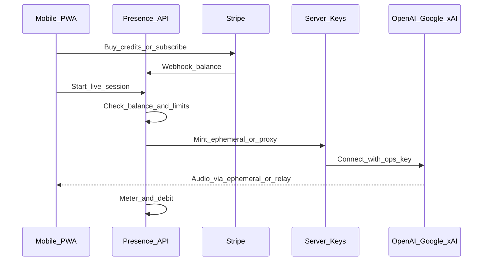

# 004 — UX 北極星: 運営キー＋クレジット/サブスクで即通話

日付: 2026-07-29  
地位: プロダクト北極星（課金・キー金庫の実装は人間承認後）  
上書き: [003](./003-go-to-market-billing.md) の「C は最後」を撤回し、**C を本線 UX**とする。BYOK は上級者向け退避口。

## 1. Verdict

ユーザが欲しいのは「キー発行して各社コンソールを開く体験」ではない。  
**Presence が API キーを持ち、ユーザはアプリを入れてクレジットを買うかサブスクするだけで、GPT Live / Gemini Live / Grok Voice と話せる。** これが本線 UX。

003 の「原価リスクが高いから BYOK だけ」は運営の安全側に寄りすぎた。黒字化と手軽さは両立できるが、**ガードレールなしの使い放題は禁止**。

## 2. ターゲット UX（完成形）

```text
インストール → ログイン → クレジット購入 or 月額プラン
  → エンジン選ぶ → 話す / 調べて
（API キー画面は出さない。上級者だけ「自分のキー」を開ける）
```

| プラン案（初期仮説・実装前に価格再確定） | 中身 |
|---|---|
| Free | 合計 N 分の音声お試し（エンジン1つ or 短時間）。テキスト少なめ |
| Credi（従量） | プリペイド分。音声は分消費、テキストは安く消費 |
| Pro（月額） | 毎月クレジット枠＋三本柱解禁。使い切ったら追加購入 |

禁止表現: 「話し放題」「全モデル聞き比べし放題」「ChatGPT Plus と同じ枠」。

## 3. なぜこれで黒字になりうるか

- ユーザ支払い = Presence 売上  
- Presence 原価 = OpenAI / Google / xAI の従量  
- **粗利 = 売上 − API 原価 − Stripe − インフラ**  
- 黒字条件: 価格表を原価の **1.5〜2.5 倍帯**に置き、セッション長・rpm・エンジン別単価でハード上限を持つ  

BYOK 月額だけ（旧 B）は手軽さで負けて離脱する。本線は Hosted。

## 4. 必ず入れるガードレール（これなしで実装しない）

1. **分メーター**: 接続〜切断の秒数でクレジット減算（切り上げ 5 秒単位など）  
2. **残高ゼロで即切断**（Live WS をサーバ側で止める）  
3. **1 セッション上限**（例: 10 分）と **1 日上限**（例: 30 分/ユーザ）  
4. **エンジン別単価**（Grok/GPT/Gemini で原価が違う。安いエンジンを誘導してよい）  
5. **ハード予算キャップ**（運営側の月次 API 予算。超えたらアプリ全体を「メンテ」）  
6. **キーはサーバのみ**（Vercel env / シークレットマネージャ。クライアントに出さない。Gemini の `?key=` 直結は廃止）  
7. **返金・有効期限**を利用規約に一文（クレジットはサービス対価。現金預かりと誤解させない）

## 5. アーキテクチャ（本線）



要点:
- ブラウザに長期キーを渡さない。OpenAI/xAI は既存どおり ephemeral。Gemini は ephemeral or 短命プロキシ必須  
- メータリングは Presence API が正。クライアント自己申告は信じない  
- BYOK モードは残す（パワーユーザ・デバッグ・原価ゼロ検証用）

## 6. フェーズ（003 を差し替え）

### Phase 0 — 実機でパイプ確認（キーはまだ自分の）

今の BYOK で三本柱＋調べてを通す。運営キー化の前に「どれが壊れるか」を知る。

### Phase H1 — Hosted の骨組み（人間が課金承認したあと）

- Auth（魔法リンク or OAuth 1つ）  
- Stripe: クレジットパック＋月額  
- 残高テーブル＋Webhook  
- `/api/voice/*` を運営キー＋残高チェックに切替  
- UI: 設定から「キー必須」を消し、「クレジット」タブへ  

### Phase H2 — 黒字運用

- 単価表を `lib/pricing.ts` に集約し、原価改定時はここだけ触る  
- 管理画面 or スクリプトで日次原価 vs 売上  
- Free お試しの濫用対策（端末指紋はやりすぎ禁止。ログイン必須で足りることが多い）  

### Phase H3 — 同席

Discord 等は Hosted メータの延長（VC 分も同じ財布から減らす）。

## 7. 人間ゲート（更新 2026-07-29）

ユーザ承認により **Hosted 実装を進行中**（理想 UX = B）。残ゲート:

1. 本番に運営 OpenAI/Google/xAI キーと Upstash / Stripe Price を置く  
2. 初期価格の確定（現状は starter/standard/plus 仮置き）  
3. 返金・有効期限文言の弁護士レビュー（[006](./006-shikin-kessai-prepaid.md)）  
4. 公開範囲（友人のみ / 誰でも）と未使用残高 1,000 万円監視運用  

## 8. 003 との関係

- 003 の Phase 0 実機チェックは存続（技術検証）  
- 003 の「C は最後」「B を本線」は **004 で破棄**  
- 黒字化計画の本線は **Hosted Credits + 任意サブスク**  
- BYOK は削除せず、設定の奥に「上級者: 自分のキー」として残す  

## 採用

UX 北極星 = 運営キー＋クレジット/サブスクで即通話。  
実装は進行中。法規クリア前の広公開はしない。
